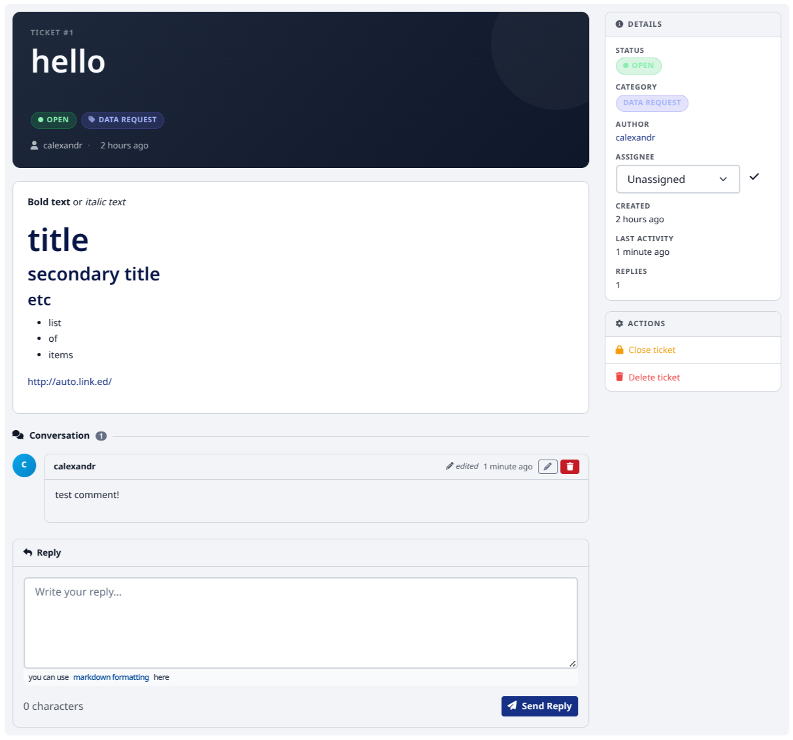

# ckanext-issues

A CKAN extension for managing and tracking support tickets ("issues") from
within the CKAN interface.

It provides:

* A **support ticket** modal available from the account navigation, so any
  logged-in user can open a ticket with a subject, category and description.
* A **"My Support Requests"** page where users can follow up on their own
  tickets and exchange messages with staff.
* A **sysadmin dashboard** (`/issues/admin`) listing every ticket, with bulk
  actions (close / reopen / remove), per-ticket assignment and a threaded
  conversation view. Open tickets where the author has the last word are
  highlighted as unread and collected in a **Needs reply** tab.
* Email notifications (new ticket → sysadmins, new reply / status change →
  ticket author, assignment → assignee), each toggleable via config. Mails
  are sent from a background job, so a CKAN worker must be running
  (`ckan jobs worker`). Set `ckanext.issues.mail_queue` to send them from a
  dedicated queue (`ckan jobs worker <queue>`).

## Requirements

Compatibility with core CKAN versions:

| CKAN version    | Compatible?   |
| --------------- | ------------- |
| 2.10            | yes           |
| 2.11            | yes           |
| 2.12            | yes           |

Requires `ckanext-tables` to be installed and enabled, and a running CKAN
background worker (`ckan jobs worker`, i.e. Redis) for email notifications.

## Installation

1. Activate your CKAN virtual environment, for example:

     . /usr/lib/ckan/default/bin/activate

2. Clone the source and install it on the virtualenv

    git clone https://github.com/DataShades/ckanext-issues.git
    cd ckanext-issues
    pip install -e .

   This also pulls in `ckanext-tables`.

3. Add `tables issues` to the `ckan.plugins` setting in your CKAN
   config file (`issues` must be listed after `tables`).

4. Run the database migrations:

     ckan db upgrade -p issues

5. Restart CKAN.

## Attachments (optional)

Users can attach files to a new ticket and to replies when
[ckanext-files](https://github.com/DataShades/ckanext-files) is installed and
its `files` plugin is enabled. Without it, ckanext-issues works as before and
the upload controls are hidden.

1. Install the extra:

     pip install -e '.[files]'

2. Add `files` to `ckan.plugins`.

3. Configure a storage for the files. On CKAN 2.12+ storages are part of core
   (`ckan.files.storage.*`); on 2.10 and 2.11 they come from ckanext-files
   (`ckanext.files.storage.*`) and need its migrations
   (`ckan db upgrade -p files`). For example, on 2.10/2.11:

     ckanext.files.storage.issues.type = files:fs
     ckanext.files.storage.issues.path = /var/lib/ckan/issues
     ckanext.files.storage.issues.initialize = true
     ckanext.issues.attachments.storage = issues

   The storage must be private: attachments are downloaded through
   `/files/download/<id>`, which only lets in the ticket author and
   sysadmins. A public storage, or one that isn't configured, turns uploads
   off (the reason is logged).

   With the development server (`ckan run`), keep the storage outside the
   folder of your config file: the reloader watches that folder and restarts
   when a `.zip` is written there, cutting the upload off.

4. Limit the request size in your web server (e.g. nginx
   `client_max_body_size`) or with Flask's `MAX_CONTENT_LENGTH`. The
   attachment limits are checked after the request has been received, so
   without this a user can still send very large requests.

Each file belongs to what it was attached to (the ticket for the opening
text, otherwise the reply), and is deleted together with it when the ticket
or reply is deleted through the API.

Purging a user deletes their tickets and replies (including replies by
others on their tickets) at the database level, and their files are left
behind. Remove such orphaned files with:

    ckan issues clean-attachments [--dry-run]

Run it after purging users, or on a schedule, e.g. a nightly cron job:

    0 3 * * * ckan -c /etc/ckan/ckan.ini issues clean-attachments

Through the action API (`issues_ticket_create`, `issues_message_create`),
files go in the `attachments` field of a multipart request. CKAN's API keeps
one file per field name, so API calls can attach one file each.

The limits (`ckanext.issues.attachments.max_files`, `max_size`,
`allowed_types`) are listed in [`config_declaration.yaml`](ckanext/issues/config_declaration.yaml).

## Config settings

See the available config options in [`config_declaration.yaml`](ckanext/issues/config_declaration.yaml).

## Developer installation

    git clone https://github.com/DataShades/ckanext-issues.git
    cd ckanext-issues
    pip install -e '.[test]'

## Tests

To run the tests, do:

    pytest --ckan-ini=test.ini

## License

[AGPL](https://www.gnu.org/licenses/agpl-3.0.en.html)
